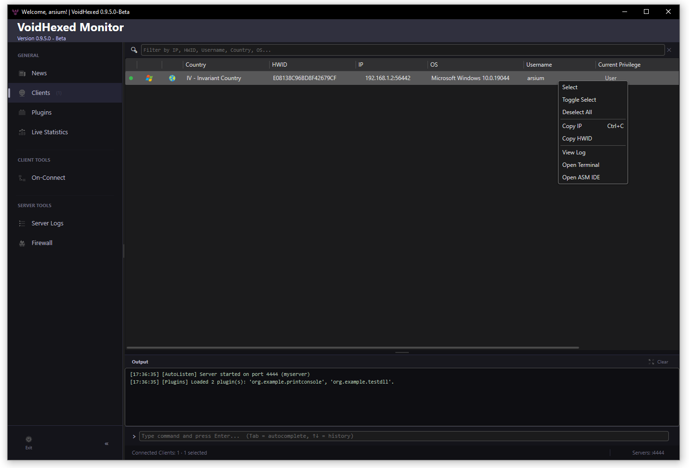
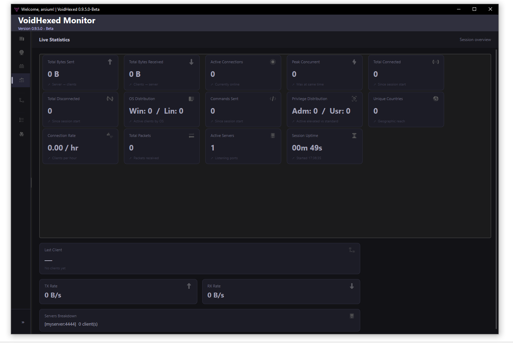
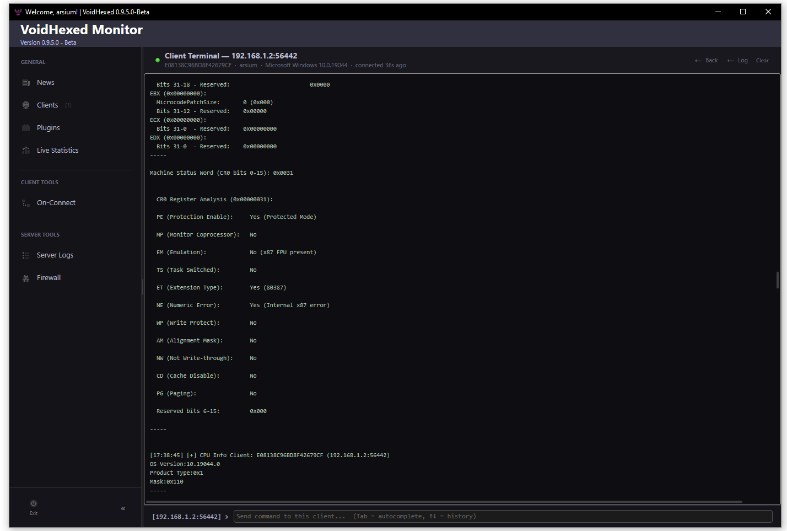
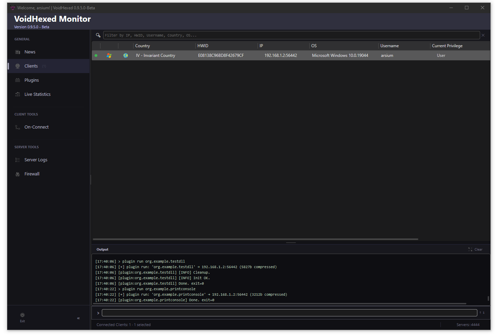
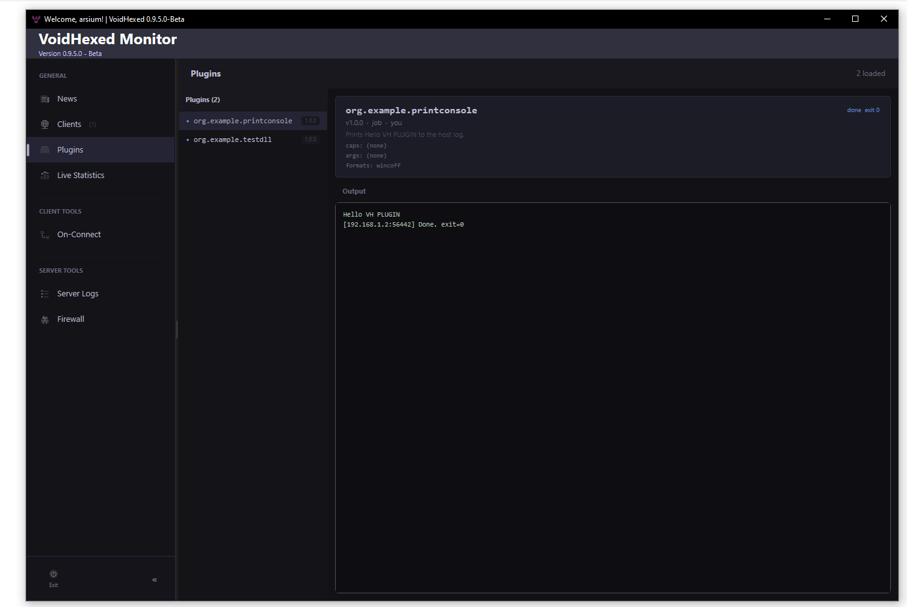
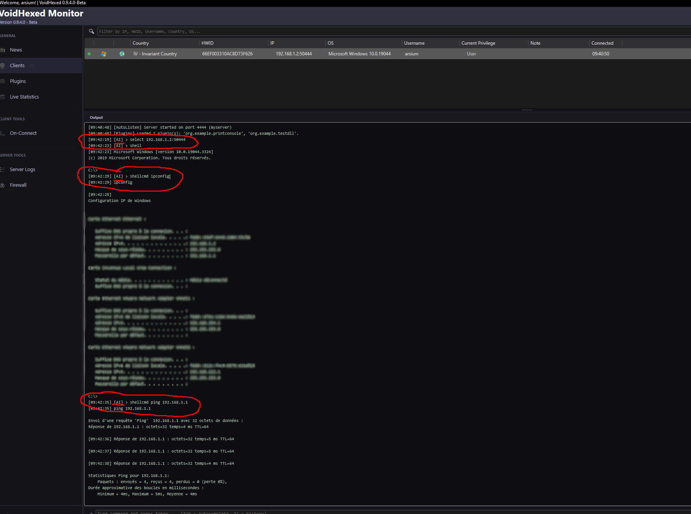

  

<h1 align="center">VoidHexed</h1>

  C2 framework for authorized security operations — Windows &amp; Linux 
  v0.9.6 · C# · .NET 10 · TLS 1.3 mTLS · AOT agents

---

## Overview

VoidHexed is a command-and-control framework built for red team operations. It pairs a native Windows GUI server with cross-platform agents compiled ahead-of-time (AOT) for Windows and Linux. Every connection is authenticated over TLS 1.3 with mutual certificate verification.

The interface is built around a command-line input with tab-completion and command history, giving operators full control without ever reaching for a separate terminal.

---

## Interface

<table>
<tr>
<td width="50%">
**Client grid** — live view of every connected agent, filterable by IP, HWID, username, country, or OS. Right-click a row to open a terminal or the ASM IDE directly.

</td>
<td width="50%">

</td>
</tr>
<tr>
<td width="50%">

**Live Statistics** — real-time session metrics: bandwidth, connection rate, OS and privilege distribution, per-server breakdown.

</td>
<td width="50%">

</td>
</tr>
<tr>
<td width="50%">

**Client terminal** — per-agent output log with a dedicated command input. Each client has its own scrollable history.

</td>
<td width="50%">

</td>
</tr>
</table>

---

## Features

### Remote Control
- **Shell** — interactive command execution (cmd / PowerShell / bash / sh)
- **File Manager** — browse remote file systems on Windows and Linux
- **Reverse Proxy** — SOCKS5 and HTTPS CONNECT tunneling; network reconnaissance on Windows (Registry + iphlpapi)
- **Memory Reader** — dump any memory range of the remote process, rendered as a hex+ASCII grid

### Intelligence Gathering
- **Stealer** — saved passwords, cookies, credit cards, messaging apps (Discord, Telegram, Outlook, WeChat), gaming tokens (Steam, Roblox), VPN configs, FTP credentials
- **System Info** — CPU, OS details, PEB/TEB inspection (Windows); full system enumeration — kernel, network, disks, processes, identity (Linux)
- **NT Syscalls** — invoke ~40 NT kernel functions directly from the operator console: process/thread control, memory operations, token manipulation, power management

### Offensive Toolkit
- **ASM IDE** — write, compile (FASM / NASM / ml64), and execute x64 shellcode directly from the interface; automatic import resolution via a patch table
- **Plugins** — deploy custom `.vhp` modules (reflective PE DLL or COFF/BOF) on demand without redeploying the agent

<table>
<tr>
<td width="50%">

Plugin execution — COFF and DLL modules

</td>
<td width="50%">

Plugin output panel with structured log levels

</td>
</tr>
</table>

### Infrastructure
- **Multi-server** — run multiple TLS listeners simultaneously, each with its own certificate
- **Firewall** — rule-based access control: IP/CIDR, country, HWID, username, OS version, privilege level; exact/contains/prefix/suffix match modes; first-match-wins evaluation
- **On-Connect tasks** — automated commands executed on each new connection, filtered by OS and target host
- **Rate limiting & heartbeat** — connection rate cap per IP, configurable agent keepalive timeout
- **Persistent logging** — all connection events, firewall hits, build history, and stealer results stored in a local SQLite database

---

## Agent Deployment

Agents are built server-side and injected with a signed license payload:

- **Windows** (`VoidWin`) — `.exe` compiled with .NET 9 AOT; payload injected into a new PE section at build time
- **Linux** (`VoidLin`) — ELF binary; payload appended as a new `PT_LOAD` segment at build time

---

## Automated Pipelines & Shell

On-connect tasks (`cfg task`) let you predefine command sequences that execute automatically the moment an agent connects — filtered by OS and target host. The screenshot below shows the operator console replaying an automated sequence: the framework selected the new client, opened a remote shell, and ran `ipconfig` and `ping` without any manual input.

  
   On-connect automation — select, shell, and shellcmd executed automatically on agent arrival

For interactive sessions, `shell` opens a persistent cmd/PowerShell session; `shellcmd <command>` sends a single command without blocking the interface. The same pattern applies to bash/sh on Linux agents.

The integrated **ASM IDE** (`asmide open`) takes this further: write x64 shellcode directly in the operator console, reference any Windows API with `"module.Function"` syntax, and send it to the selected agent with one command. The preprocessor replaces API references with random 8-byte placeholders; the agent resolves them to real addresses at runtime. FASM, NASM, and ml64/MASM are all supported.

---

> **Source code is not and will not be publicly released.**

> **For authorized security testing only.**  
> Use of this software against systems you do not own or have explicit written permission to test is illegal.
